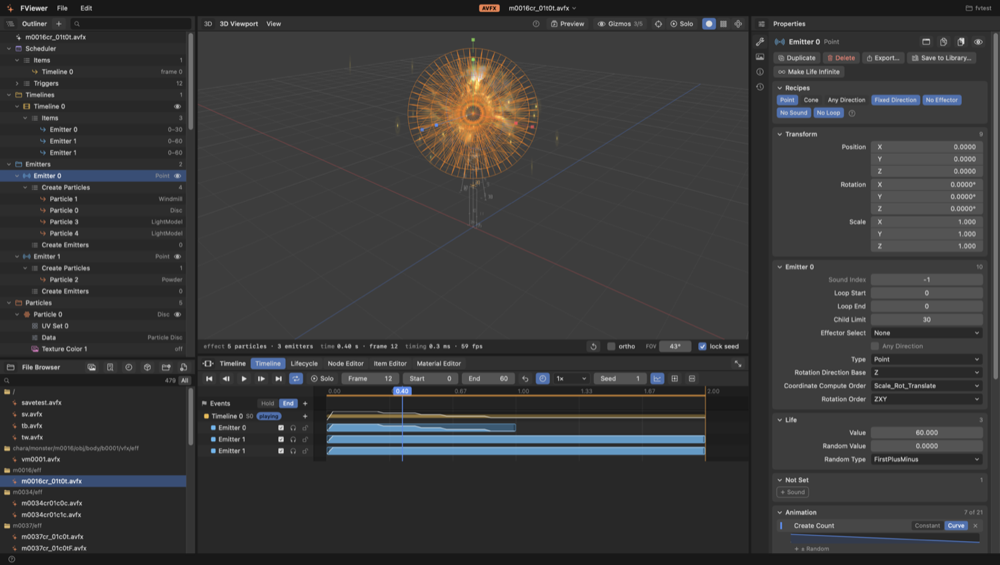
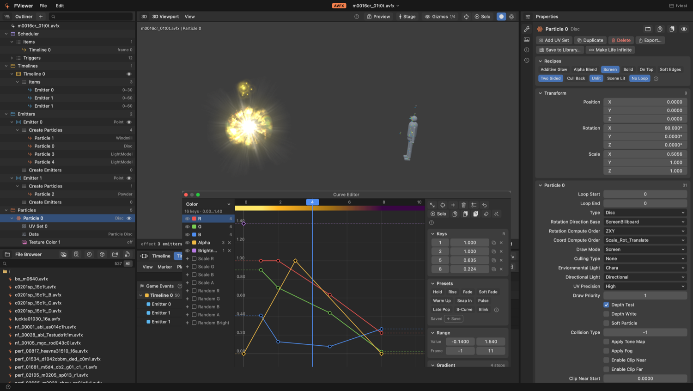
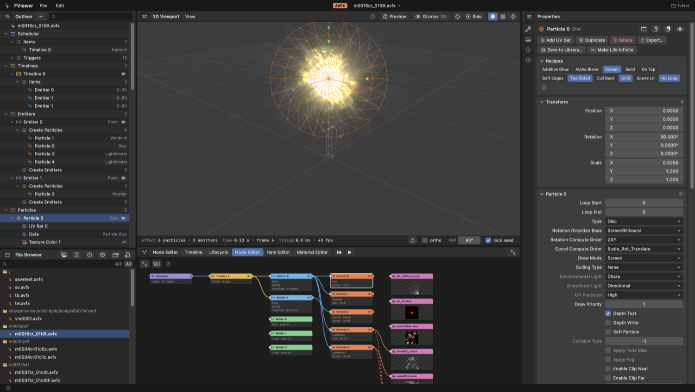
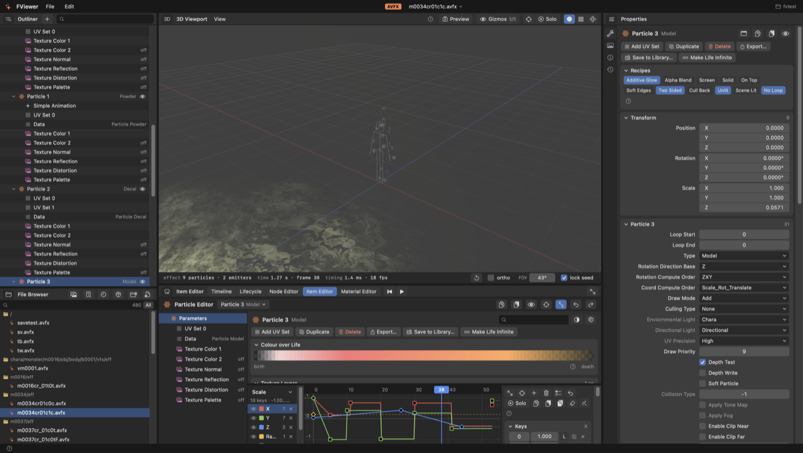
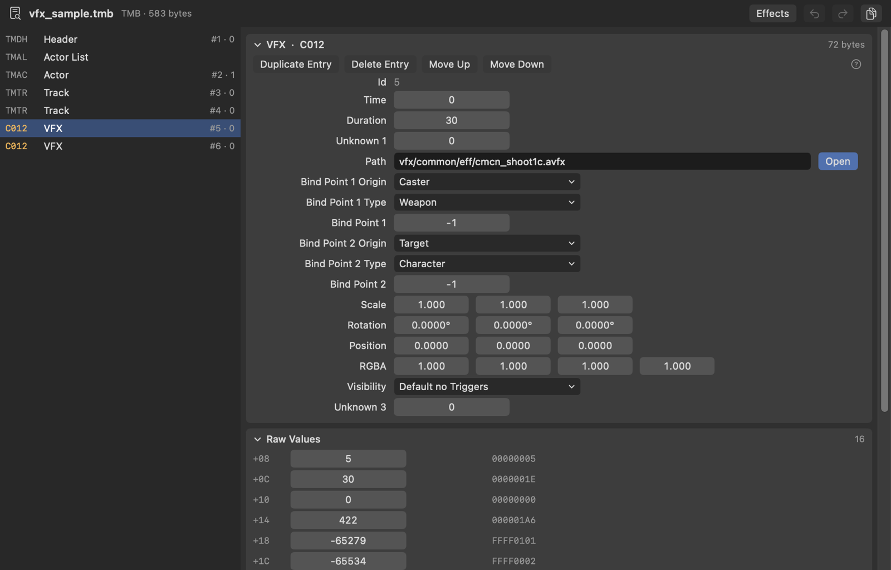

# FViewer

A macOS editor for FINAL FANTASY XIV visual effects (`.avfx`). It opens an effect, plays it in a 3D viewport, lets you change every value the file holds, and writes the result back to a new file. It also reads and edits the game files an effect depends on: timelines, materials, skeleton data and others.

Built with SwiftUI and Metal. Requires macOS 15.7 or later and Xcode to build.

## Building

Open `FViewer.xcodeproj` in Xcode and run the `FViewer` scheme. There are no external dependencies. The 2D runtime is a local Swift package in `Packages/VfxRuntime`.

### Signing

Signing settings are not stored in the project. Copy `Config/Local.xcconfig.example` to `Config/Local.xcconfig` and set your team and bundle ID suffix. The file is ignored by git. Do not pick a team in Signing & Capabilities, Xcode would write it back into the project file.

## Opening files

- **File → Open File** opens a single `.avfx` effect or a `.json` effect of the Pixi runtime.
- **File → Open Folder** scans a folder of extracted game files. Effects appear in the File Browser. Textures and models are found by their game path.
- **File → Game** works with an installed game. Set the `sqpack` folder once, then open files from the archives by game path.
- Files can also be dropped onto the window.

Originals are never overwritten. **Save** writes a copy next to the source with an `F` added to the name.

## The main window

| Area | What it does |
|---|---|
| Outliner | The effect as a tree: scheduler, timelines, emitters, particles, effectors, binders, textures, models. Items can be added, duplicated, deleted and hidden. |
| Viewport | Live preview. Drag to orbit, right-drag to pan, scroll to zoom; `1`, `3`, `7` switch to front, side and top views. The selected item gets move, rotate and scale handles. |
| Properties | Every field of the selected item with its name from VFXEditor. A dot marks values that differ from the file on disk. |
| File Browser | The open folder. Other tabs show the node library, history, texture and model assets, and the remaining game files of the folder. |
| Bottom area | Timeline, Graph Editor, Node Editor, Item Editor. |

## Editors

### Timeline

Strips show when each emitter of a timeline starts and ends. Drag a strip to move it, drag its edge to change its length. The curve inside a strip is the number of live particles on each frame. The timeline row shows the total.

Playback controls set the frame, the end frame, speed, loop and the random seed. **Release** lets held particles and emitters play out, as when the game ends an effect.

### Graph Editor

Edits animation curves: position, rotation, scale, colour and every other curve an item has. Keys can be added, moved, copied and given a type. Extrapolation and random settings are on the right.

### Node Editor

Shows how the parts of the effect refer to each other: scheduler → timelines → emitters → particles → textures and models. Drag from one socket to another to connect. If a connection is not possible, the editor says why.

### Item Editor

One particle, emitter or other item on a single page: parameters, texture layers with a combined preview, colour over life and curves.

## Preview

The viewport plays the effect: emitters, particles, texture layers with their blend and UV settings, distortion, palette, soft particles, trails, light effectors, screen blur effectors and camera quake. It follows the reference previewers, not the game itself, so small differences from the game are possible.

- **File → Game → Load Skeleton** shows a game skeleton with its bind points, so an effect bound to a point is drawn at that point.
- **File → Game → Load Model** shows a game model with its texture as a reference object. **Load Model of This Effect** finds the model and skeleton from the effect's path.
- **Settings → Preview Rules** lists the rules the preview follows. Each can be switched off.
- **Effect Info → Preview Notes** lists what the preview does not draw for the open effect.

Not drawn: Dissolve particles, Black Hole effectors, normal and reflection textures.

## Textures

Textures are read from `.atex` and `.tex` (BC1–BC5, BC7 and uncompressed formats). The Texture Editor shows a texture with its mip levels and channels, replaces it from an image file, and converts between `.atex`, `.tex`, `.dds` and `.png`.

## File Inspector

**File → Game → Inspect Game File** opens other game formats. Edits can be undone, saved as a copy, or exported as a one-file mod.

| Format | What can be edited |
|---|---|
| `.tmb`, `.pap` | Timeline entries of every type with named fields; add, duplicate, delete and reorder entries, tracks and actors. Animation names in `.pap`. |
| `.eid` | Bind points: bone, position, rotation. |
| `.mtrl` | Shader, textures, UV and colour sets, shader keys, constants, samplers, colour table. |
| `.phyb` | Collision shapes and simulators with chains, nodes, connectors, springs. |
| `.kdb` | Nodes, connections, bones and weights. |
| `.skp`, `.atch`, `.imc` | Look-at and slope parameters, weapon attach points, model variants. |
| `.scd` | Lists sounds, plays PCM and MS ADPCM, replaces a sound from an audio file. |
| `.mdl`, `.sklb`, `.tex` | View only; models and skeletons can be sent to the viewport. |

## Exporting mods

**File → Export Mod** packs the open effects and their changed textures as a Penumbra `.pmp` or a TexTools `.ttmp2`, using each file's game path. Options can be grouped so one mod offers several variants.

## Finding things

- **File → Game → Game Catalog** lists common effects, timelines and animations and the files of each monster model.
- **Find Effects Using a Texture or Model** searches the open folder for effects that mention a name.
- **Effects of Timeline** lists the effects a `.tmb` or `.pap` starts; **Timelines Using This Effect** does the reverse.

## Contributing

See [CONTRIBUTING.md](CONTRIBUTING.md) and [CHANGELOG.md](CHANGELOG.md).

## License

[MIT](LICENSE). Field names, defaults and file layouts come from [Dalamud-VFXEditor](https://github.com/0ceal0t/Dalamud-VFXEditor); its notice is in [THIRD_PARTY_NOTICES.md](https://github.com/Croakieee/FViewer/blob/main/.github/THIRD_PARTY_NOTICES.md).

FINAL FANTASY XIV is a registered trademark of SQUARE ENIX CO., LTD. This project is not affiliated with SQUARE ENIX and contains no game assets.
